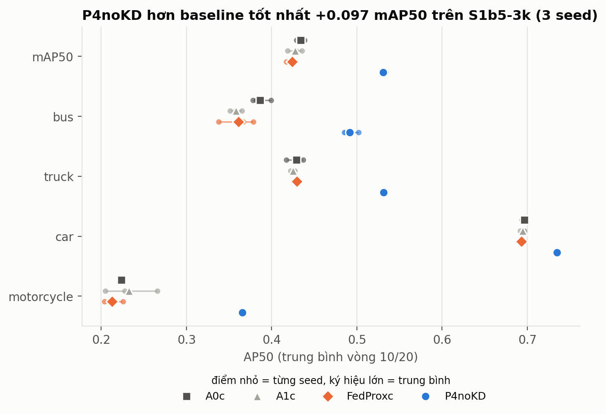
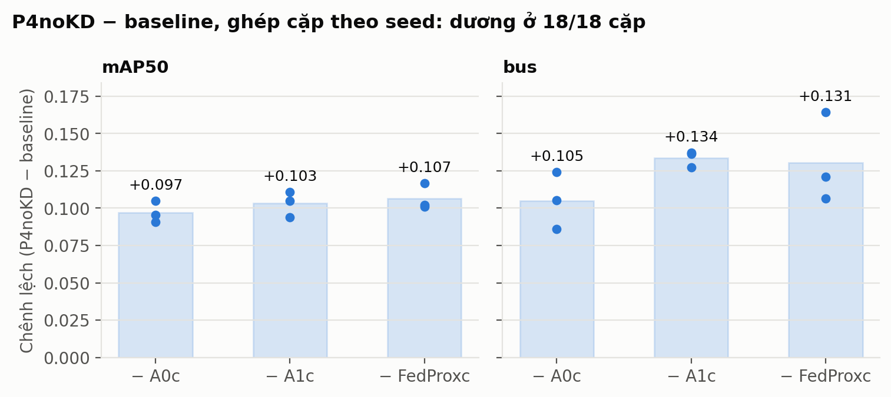
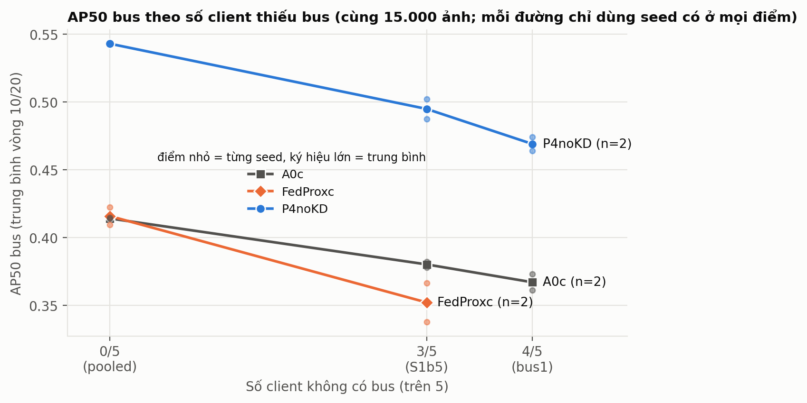
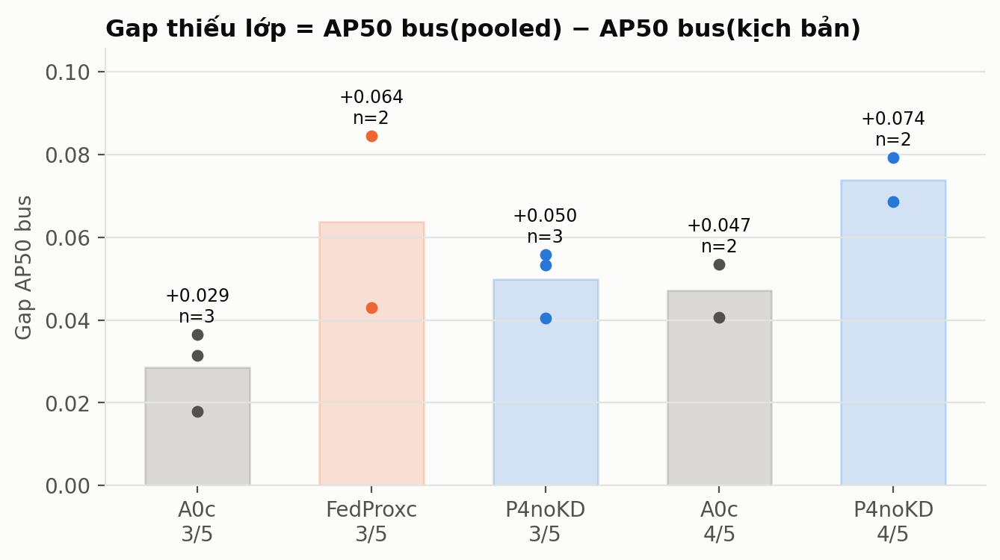
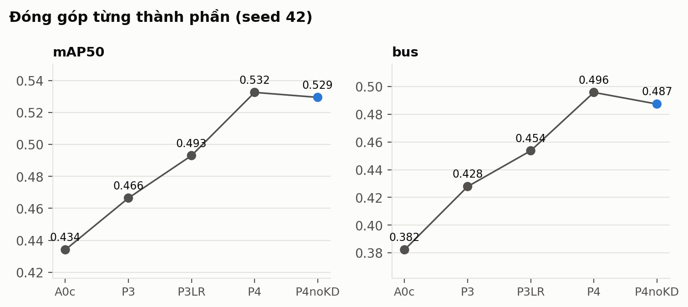
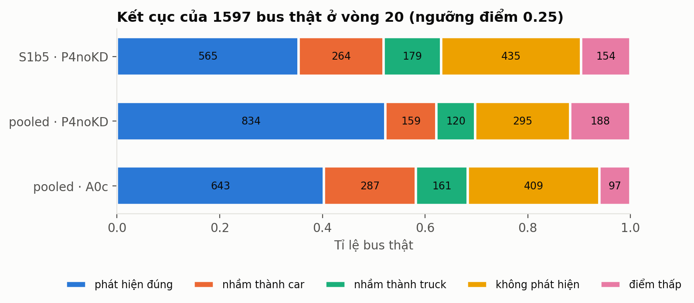
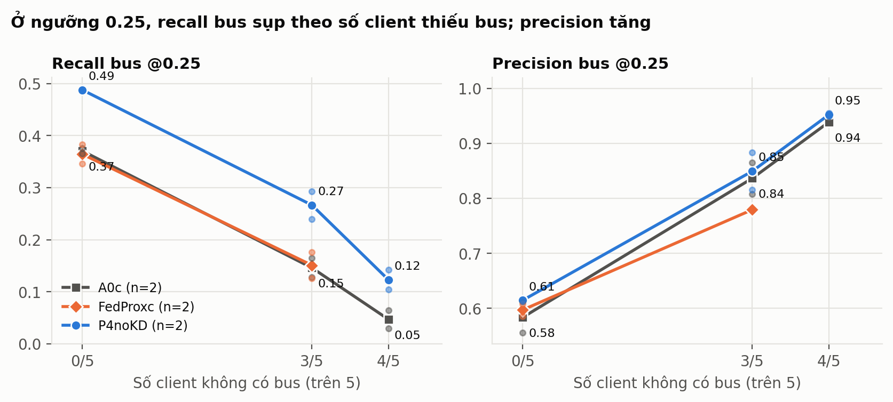
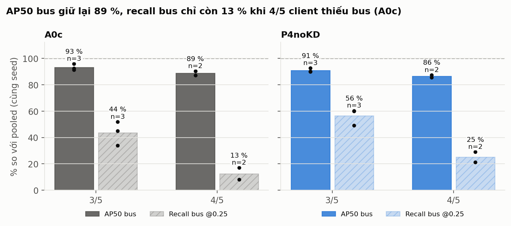

# Dàn ý báo cáo — Missing-Class Non-IID trong Federated YOLO (BDD100K)

> Cập nhật: 2026-10-19. Mọi con số dưới đây lấy từ `research/experiment_registry/registry.yaml`
> (cột **Nguồn** ghi ID thí nghiệm hoặc ADR) — khi viết báo cáo, trích đúng nguồn này.
> Quy ước số liệu: AP50 theo lớp và mAP50 trên tập val BDD100K (9.905 ảnh), cùng một bộ đánh giá cho mọi
> phương pháp; "trung bình vòng 10/20" = trung bình của hai lần đánh giá ở vòng 10 và vòng 20 (quy tắc chốt trước, ADR-011/019).
> Mục nào còn chờ kết quả được đánh dấu **[CHỜ]**.

---

## 1. Làm gì

**Một câu:** đo xem việc một số client *hoàn toàn không có* một lớp đối tượng (Missing-Class Non-IID) làm
detector YOLO huấn luyện liên kết kém đi bao nhiêu, và kiểm chứng những can thiệp nào giảm được thiệt hại đó.

- **Bài toán:** phát hiện 4 lớp giao thông — car, bus, truck, motorcycle — trên BDD100K, YOLO + Flower, 5 client.
- **Câu hỏi nghiên cứu:** khi một số client không có lớp *c*, bảo toàn tri thức ở client và gộp mô hình có nhận
  biết lớp ở server có giảm được suy giảm của lớp *c* mà không làm hại detector chung không?
- **Ba giả thuyết** (đều là giả thuyết của luận văn, phải kiểm chứng bằng thí nghiệm):

| Mã | Giả thuyết | Được ủng hộ khi | Bị bác bỏ khi |
|---|---|---|---|
| H1 | Client thiếu lớp *c* làm giảm khả năng phát hiện *c* của mô hình toàn cục | So với đối chứng cùng dữ liệu, AP lớp *c* giảm nhất quán qua seed | Không có gap, gap không ổn định, hoặc do lượng dữ liệu khác nhau |
| H2 | Hạn chế cập nhật phần tham số gắn với lớp bị thiếu ở client giữ được tri thức cũ | Lớp mục tiêu tăng ở mọi seed, lớp khác không hỏng | Không tách được tham số theo lớp / không lặp lại |
| H3 | Gộp theo từng lớp ở server tốt hơn trọng số theo client | Hơn baseline ở lớp thiếu/hiếm | Lợi ích được giải thích bởi trọng số theo số lượng lớp |

**Thông điệp khi trình bày:** đây là nghiên cứu có kiểm soát theo chuỗi
*giả thuyết → bằng chứng → can thiệp → thí nghiệm có đối chứng → kết luận*, không phải cuộc đua mAP;
kết quả âm được giữ và báo cáo.

---

## 2. Tại sao làm vậy (động cơ và căn cứ)

| Lý do | Căn cứ | Nguồn |
|---|---|---|
| Học liên kết suy giảm mạnh khi dữ liệu non-IID; trường hợp "thiếu hẳn lớp" là dạng cực đoan của lệch nhãn | Zhao et al. 2018 (arXiv): độ chính xác FedAvg giảm mạnh khi mỗi client chỉ có ít lớp | `literature_registry.yaml: zhao2018noniid` |
| Thực tế giao thông: mỗi camera/xe chỉ thấy một số loại phương tiện (tuyến không có bus…) | Tính chất của BDD100K (nhiều cảnh, nhiều thành phố) | `bdd100k` (CVPR 2020) |
| FL cho phát hiện đối tượng ít được nghiên cứu hơn phân loại; detector có head phân loại *sigmoid độc lập* và nhánh hồi quy dùng chung, nên kết quả từ phân loại ảnh không tự chuyển sang được | Kiến trúc Detect của Ultralytics 8.3.253 (cv2 = hồi quy, cv3 = phân loại) | `research/feasibility/F1/parameter_map.yaml` |
| Đã có kết quả FedAvg tụt so với huấn luyện tập trung ngay cả khi IID | G2 tập trung mAP50 0,488 vs G3 FedAvg IID 0,377 (YOLOv8n, 1 seed) | `EXP-2026-10-03-S2v3-G2`, `-G3-FedAvg-S0` |
| Các phương pháp chống non-IID chuẩn cần được kiểm tra trên đúng bài toán này | FedAvg (AISTATS 2017), FedProx (MLSys 2020), SCAFFOLD (ICML 2020), FedNova (NeurIPS 2020) | `literature_registry.yaml` |
| Hướng can thiệp có căn cứ tài liệu cho phần "phân loại bị lệch" | FedNTD (NeurIPS 2022), EFL (CVPR 2022), CCVR (NeurIPS 2021), FedBABU (ICLR 2022), khởi tạo tiền huấn luyện (ICLR 2023) | `fedntd`, `efl2022`, `ccvr2021`, `fedbabu2022`, `nguyen2023where` |

**Vì sao cần đối chứng "cùng dữ liệu, chỉ khác phân bố":** nếu so S1 với một tập khác, chênh lệch có thể do
*lượng* dữ liệu bus chứ không do *thiếu lớp*. Bằng chứng: đối chứng "khớp" ban đầu có **2,03×** số box bus
so với S1b (ADR-014), nên phải dùng bản chia lại (pooled) đúng cùng tập ảnh.

---

## 3. Kịch bản dữ liệu

Môi trường cố định (`environment.lock`): Python 3.12, PyTorch 2.7.1+cu128, Ultralytics 8.3.253, Flower 1.21.0,
GPU Kaggle T4 ×2. Partition tất định, lưu `partition_manifest`.

### 3.1 Kịch bản chính — cùng 15.000 ảnh, chỉ đổi "ai giữ ảnh nào"

| Kịch bản | Mô tả | Client thiếu bus | Client thiếu truck | Nguồn |
|---|---|---|---|---|
| **Pooled (lý tưởng, IID)** | 15.000 ảnh chia đều lại cho 5 client, phân tầng theo tổ hợp lớp | 0/5 | 0/5 | ADR-014, ADR-017 |
| **S1b5-3k (chính)** | 5 client × 3.000 ảnh; bus vắng C0–C2, truck vắng C3 | 3/5 | 1/5 | ADR-017 |
| **S1b5-bus1 (nặng hơn)** | cùng 15.000 ảnh, bus chỉ ở C4; truck vẫn vắng C3 | 4/5 | 1/5 | ADR-022 (2/3 seed; seed 2024 **[CHỜ s18c]**) |

Số box của từng client (kiểm tra từ manifest, 2026-10-19):

| Client | S1b5: bus / truck | Pooled: bus / truck |
|---|---|---|
| C0 | **0** / 1.489 | 499 / 1.334 |
| C1 | **0** / 1.296 | 522 / 1.274 |
| C2 | **0** / 1.264 | 538 / 1.279 |
| C3 | 1.380 / **0** | 519 / 1.240 |
| C4 | 1.248 / 2.372 | 550 / 1.294 |
| **Tổng** | bus 2.628, car 155.250, truck 6.421, moto 1.963 | **giống hệt** |

- Lý do chọn 5 client × 3.000 ảnh và tăng motorcycle: ở kịch bản cũ 4 × 2.000 ảnh chỉ có 347 box motorcycle,
  AP50 motorcycle ≤ 0,05 ở mọi nhánh → lớp hiếm không đo được (ADR-017).
- Lý do giữ nguyên tổng ảnh, tổng box và kích thước client: để mọi chênh lệch chỉ có thể đến từ **phân bố**.

### 3.2 Kịch bản giai đoạn đầu (YOLOv8n, dùng cho bằng chứng H1 ban đầu)
S1b-2k: 4 client × 2.000 ảnh, bus vắng 2/4 client; đối chứng khớp (S1-Control-Matched) và pooled (ADR-014).

---

## 4. Phương pháp

### 4.1 Mô hình và giao thức
- **Mô hình:** YOLO11s giữ nguyên head 80 lớp COCO (car = 2, motorcycle = 3, bus = 5, truck = 7).
  - *Vì sao YOLO11s:* zero-shot trên BDD, tier s hơn YOLOv8n +0,086–0,101 mAP50 và +0,076–0,086 AP50 bus —
    lớn hơn mọi hiệu ứng phương pháp đo được lúc đó; YOLO11s hơn YOLOv8s ở cả 4 lớp với ít hơn 16 % tham số
    (`EXP-2026-10-08-EVAL-model-zoo`, ADR-016).
  - *Vì sao giữ head COCO:* YOLOv8n COCO chưa huấn luyện trên BDD đã đạt AP50 bus 0,294 — ngang teacher huấn
    luyện riêng (0,289) và hơn mọi nhánh FL; khởi tạo lại head làm mất tri thức này (`EXP-2026-10-07-EVAL-COCO-teacher`, ADR-018).
- **FL:** 5 client, 20 vòng × 1 epoch cục bộ, đánh giá ở vòng 10 và 20; seed 42, 123, 2024; mọi phương pháp
  dùng cùng partition, cùng mô hình khởi tạo, cùng bộ đánh giá.

### 4.2 Các phương pháp so sánh

| Mã | Server | Client | Vai trò | Căn cứ |
|---|---|---|---|---|
| **A0c** | FedAvg | không | baseline gốc | FedAvg 2017 |
| **A1c** | Class-count FedAvg (gộp hàng của lớp theo số box) | không | đối chứng H3 | ADR-007, ADR-021 |
| **FedProxc** | FedAvg | proximal term μ = 0,01 | baseline non-IID chuẩn | FedProx 2020, ADR-010 |
| **P3** | FedAvg | chưng cất "not-true" từ COCO model đóng băng | thử bảo toàn tri thức | FedNTD 2022, ADR-018 |
| **P4** | FedAvg | P3 + learning rate cosine theo vòng + RFS t = 0,5 | thêm 2 thành phần | Li et al. (arXiv:1907.02189), ADR-019 |
| **P4noKD** | FedAvg | cosine LR + RFS, **bỏ chưng cất** | phương pháp được chọn | ADR-019 phụ lục |
| **N1** | CCVR: hiệu chỉnh hàng phân loại sau huấn luyện | – | kiểm tra "lệch bộ phân loại" | CCVR 2021, ADR-020 |
| **P5f** | FedAvg | P4noKD + đóng băng conv phân loại | kiểm tra "lệch bộ phân loại" | FedBABU 2022, ADR-020 |

- **Không chạy, có lý do:** SCAFFOLD — cài đặt hiện tại không làm đúng hiệu chỉnh control variate nên bị chặn trong
  code; FedNova — client bằng kích thước và cùng số bước cục bộ thì FedNova trùng FedAvg (ADR-021).

### 4.3 Thước đo
- AP50 từng lớp, mAP50, mAP50-95, FP/FN từng lớp (ngưỡng 0,25), phân rã lỗi bus (D1).
- **Gap thiếu lớp:** `gap(phương pháp) = AP50_bus(pooled) − AP50_bus(S1b5)`, ghép cặp theo seed.
  Phương pháp chỉ là "giải pháp cho thiếu lớp" khi gap của nó **nhỏ hơn** gap của FedAvg.
- Quy tắc quyết định của mỗi thí nghiệm được **ghi trong ADR trước khi chạy** (chống chọn lọc kết quả).

---

## 5. Lộ trình thực nghiệm và lý do mỗi bước

| Bước | Làm gì | Kết quả dẫn tới bước sau | Nguồn |
|---|---|---|---|
| G1 | Cố định môi trường trên Kaggle | Phát hiện smoke FL không cập nhật trọng số (nbs 64 → ~3 bước/vòng), sửa | `gates.yaml` |
| G2/G3 | Tập trung vs FedAvg IID (YOLOv8n) | 0,488 vs 0,377 mAP50 | `EXP-...-S2v3-*` |
| H1 sơ bộ | S1b vs đối chứng vs pooled (YOLOv8n) | Có gap bus; tách được phần do lượng dữ liệu | ADR-014 |
| H2/H3 (YOLOv8n) | A1, A3, A2b, A4b, A5, A6 | Tất cả không hơn FedAvg ở bus → chuyển hướng | `EXP-...-S5/S6/S7-*` |
| Dữ liệu server | Teacher T, B1, B2, P1, P2 | Tiền huấn luyện giúp; chưng cất giúp thêm; ρ không giúp | ADR-015 |
| Mô hình | Đánh giá zero-shot 4 mô hình COCO | Chuyển sang YOLO11s giữ head COCO | ADR-016, ADR-018 |
| P3 → P4 → P4noKD | Thêm từng thành phần | Cosine LR và RFS là phần tạo lợi ích; chưng cất không cần | ADR-019 |
| Lệch bộ phân loại | D1, N1 (CCVR), P5f (FedBABU) | Không thu hẹp gap → đóng hướng này | ADR-020 |
| Đa seed | A0c, P4noKD × 3 seed | P4noKD thắng 3/3 | `EXP-...-S16-*` |
| Baseline | A1c, FedProxc × 3 seed; IID | P4noKD thắng 3/3; nhưng gap không giảm | ADR-021 |
| Mức độ thiếu | bus 4/5; FedProxc trên pooled | Gap A0c tăng theo mức thiếu; P4noKD, FedProxc không thu hẹp gap (2/3 seed) | ADR-022 |

---

## 6. Kết quả (có số liệu)

### 6.1 H1 — thiếu lớp có gây suy giảm không

**(a) YOLOv8n, S1b-2k, FedAvg, trung bình vòng 20/25/30**

| Seed | S1b (bus vắng 2/4) | Đối chứng khớp | Pooled (cùng ảnh) |
|---|---:|---:|---:|
| 42 | 0,2314 | 0,2783 | 0,2606 |
| 123 | 0,2253 | 0,2624 | – |
| 2024 | 0,2267 | 0,2793 | – |

- Pooled − S1b = **+0,029** AP50 bus (seed 42): phần do **phân bố**; đối chứng − pooled = +0,018: phần do
  **lượng dữ liệu bus** (đối chứng có 2,03× box bus) — `EXP-2026-10-05-S7-A0at-pooled`.
- Phân rã lỗi (3 seed, vòng 30): bus bị bỏ sót thêm ở S1b so với đối chứng ≈ +204 nhầm thành truck, +202 nhầm
  thành car, +193 không phát hiện, −52 điểm thấp → chủ yếu **nhầm lớp** — `EXP-2026-10-05-S7-D1-errors`.

**(b) YOLO11s, S1b5-3k vs pooled, trung bình vòng 10/20**

| Phương pháp | Seed | AP50 bus S1b5 | AP50 bus pooled | Gap bus | Gap truck | Gap car |
|---|---|---:|---:|---:|---:|---:|
| A0c | 42 | 0,382 | 0,414 | **+0,031** | −0,019 | +0,002 |
| A0c | 123 | 0,378 | 0,415 | **+0,036** | +0,012 | −0,002 |
| P4noKD | 42 | 0,487 | 0,543 | **+0,056** | +0,019 | +0,001 |
| P4noKD | 123 | 0,502 | 0,543 | **+0,040** | +0,020 | +0,003 |
| A0c | 2024 | 0,399 | 0,417 | **+0,018** | −0,005 | −0,002 |
| P4noKD | 2024 | 0,485 | 0,539 | **+0,053** | +0,014 | +0,003 |

Nguồn: `S12-A0c`, `S12-P4noKD`, `S13-*-pooled`, `S16-*`, `S17-*-s5pooled`.

### 6.2 H2/H3 trên YOLOv8n — các can thiệp không hơn FedAvg

| Nhánh | Ý tưởng | AP50 bus | Δ so với A0 (0,2314) | Nguồn |
|---|---|---:|---:|---|
| FedProx | proximal term | 0,2341 | +0,003 | `S5-FedProx` |
| A1 | trọng số theo số box | 0,2108 | −0,021 | `S5-A1` |
| A3 | A1 + giữ hàng khi không ai có lớp | 0,2075 | −0,024 | `S5-A3` |
| A2b ρ = 0,25 | bảo toàn theo loss ở client | 0,2217 | −0,010 | `S5-A2b` |
| A4b ρ = 0,25 (3 seed) | A3 + A2b | 0,2134 (TB) | −0,016 / −0,015 / −0,012 (seed 42 / 123 / 2024) | `S5/S6-A4b` |
| A5 | chưng cất not-true | 0,2073 | −0,024; FP bus +486 % | `S7-A5` |
| A6 | Equalized Focal Loss | 0,1561 | −0,075 | `S7-A6` |
| P1 | KD từ teacher T (dữ liệu server 1k) | 0,2996 | +0,068 (P1 − B1 = +0,025) | `S8-P1` |

### 6.3 Phương pháp chính trên YOLO11s (3 seed)

**Đóng góp từng thành phần (seed 42, trung bình vòng 10/20):**

| Nhánh | mAP50 | AP50 bus | Ghi chú | Nguồn |
|---|---:|---:|---|---|
| A0c | 0,434 | 0,382 | FedAvg | `S12-A0c` |
| P3 (vòng 20) | 0,472 | 0,425 | + chưng cất | `S11-P3` |
| P3LR | 0,493 | – | + cosine LR: +0,026 bus so với P3 | `S12-P3LR` |
| P4 | 0,532 | – | + RFS | `S12-P4` |
| P4noKD | 0,529 | 0,487 | P4 − P4noKD = +0,008 bus < 0,010 → bỏ KD | `S12-P4noKD` |

**So với baseline, mean ± std trên seed 42/123/2024:**

| Phương pháp | mAP50 | AP50 bus | car | truck | motorcycle | FN bus |
|---|---:|---:|---:|---:|---:|---:|
| A0c (FedAvg) | 0,434 ± 0,005 | 0,387 ± 0,011 | 0,697 | 0,429 | 0,223 | 1.395 |
| A1c | 0,428 ± 0,009 | 0,358 ± 0,007 | 0,695 | 0,425 | 0,233 | 1.311 |
| FedProxc | 0,424 ± 0,006 | 0,361 ± 0,021 | 0,693 | 0,430 | 0,213 | 1.425 |
| **P4noKD** | **0,531 ± 0,002** | **0,492 ± 0,009** | **0,735** | **0,531** | **0,366** | **1.224** |

**Chênh lệch P4noKD − baseline theo từng seed (42 / 123 / 2024):**

| So với | mAP50 | AP50 bus | Thắng cả 3 seed? |
|---|---|---|---|
| A0c | +0,095 / +0,105 / +0,091 | +0,105 / +0,124 / +0,086 | Có |
| A1c | +0,111 / +0,105 / +0,094 | +0,136 / +0,137 / +0,127 | Có |
| FedProxc | +0,101 / +0,117 / +0,102 | +0,121 / +0,164 / +0,107 | Có |

Nguồn: `S16-*`, `S17-*`, ADR-021. P4noKD hơn cả ba ở **mọi lớp, mọi seed**.

**Trường hợp IID (pooled):** P4noKD − A0c = mAP50 +0,108 / +0,104 / +0,112, bus +0,130 / +0,128 / +0,121
(seed 42 / 123 / 2024) → **không làm IID kém đi, đạt 3/3 seed** (luật 3, ADR-021).

### 6.4 Kiểm tra giả thuyết "lệch bộ phân loại" (ADR-020, seed 42)

| Thử nghiệm | Kết quả | Kết luận |
|---|---|---|
| D1 trên P4noKD vòng 20 (1.597 bus) | S1b5 − pooled: nhầm car + truck **+164**, không phát hiện **+140**, điểm thấp −34 | Ủng hộ yếu: gần một nửa phần dôi là "không phát hiện" |
| N1 (CCVR) | mAP50 0,557 → 0,448; bus 0,530 → 0,412; FP bus 205 → 364.302 | Bác bỏ (lỗi thiết kế tỉ lệ mẫu ảo nền/dương, không tinh chỉnh lại) |
| P5f (đóng băng phân loại) | bus +0,005 so với P4noKD (cần +0,010); vòng 20 trùng P4noKD (0,530 vs 0,530) | Không phải đóng góp riêng cho thiếu lớp |

### 6.5 Mức độ thiếu và FedProx (ADR-022; seed 42 / 123, seed 2024 **[CHỜ s18c]**)

Kiểm tra partition (log phiên): bus1 có bus = 0 ở C0–C3, 2.628 box ở C4; truck vẫn vắng C3; cùng 15.000 ảnh.

**AP50 bus theo số client thiếu bus (seed 42 / 123):**

| Phương pháp | 0/5 (pooled) | 3/5 (S1b5) | 4/5 (bus1) |
|---|---|---|---|
| A0c | 0,414 / 0,415 | 0,382 / 0,378 | 0,373 / 0,361 |
| P4noKD | 0,543 / 0,543 | 0,487 / 0,502 | 0,464 / 0,474 |
| FedProxc | 0,409 / 0,422 | 0,367 / 0,338 | không chạy |

**Gap bus = pooled − kịch bản (seed 42 / 123):**

| Phương pháp | Gap ở 3/5 | Gap ở 4/5 |
|---|---|---|
| A0c | +0,031 / +0,036 | +0,041 / +0,053 |
| P4noKD | +0,056 / +0,040 | +0,079 / +0,069 |
| FedProxc | +0,043 / +0,085 | – |

- **R1 đạt 2/2 seed (tạm thời):** gap A0c tăng từ 3/5 lên 4/5 (+0,009 / +0,017) → thiệt hại tăng theo mức thiếu,
  nhưng vẫn nhỏ (≤ 0,053 AP50, ≤ 13 % AP bus pooled).
- **R2 không đạt (2/2 seed):** gap P4noKD ở 4/5 lớn hơn A0c; nhưng AP50 bus tuyệt đối của P4noKD vẫn cao hơn A0c
  +0,091 / +0,113.
- **R3 không đạt (2/2 seed):** gap FedProxc ở 3/5 lớn hơn A0c. Trên pooled FedProxc ≈ A0c (mAP50 −0,008 / +0,002)
  → phần thua FedAvg của FedProx chỉ xuất hiện khi có client thiếu bus.
- Lớp không mục tiêu từ 3/5 → 4/5: car, motorcycle thay đổi ≤ 0,011; truck giảm (A0c −0,023 / −0,011; P4noKD −0,021 /
  −0,007) — phân bố truck ở các client khác cũng đổi khi chia lại, nên chỉ báo cáo, không diễn giải.

Nguồn: `S18-*`, ADR-022; hình `research/figures/fig3_bus_vs_severity`, `fig4_missing_class_gap`.

### 6.6 Ở ngưỡng vận hành, thiệt hại lớn hơn nhiều so với AP50 (phân tích khám phá)

Mỗi run ghi TP/FP/FN, precision, recall theo lớp tại `operating_conf = 0,25` (cùng evaluator, cùng quy tắc trung bình
vòng 10/20; trường `results.operating_r10_20` trong registry). Đây **không phải tiêu chí đăng ký trước** → chỉ là quan sát.

**Bus ở ngưỡng 0,25 (seed 42 / 123 / 2024; mức 4/5 chỉ seed 42 / 123):**

| Phương pháp | Kịch bản | Recall bus | Precision bus | TP bus (/1.597) | FP bus |
|---|---|---|---|---|---|
| A0c | 0/5 | 0,365 / 0,376 / 0,362 | 0,61 / 0,56 / 0,62 | 550 / 586 / 546 | 804 / 930 / 794 |
| A0c | 3/5 | 0,164 / 0,128 / 0,188 | 0,81 / 0,87 / 0,82 | 210 / 163 / 233 | 86 / 57 / 74 |
| A0c | 4/5 | **0,030 / 0,064** | 0,94 / 0,94 | **39 / 75** | 12 / 29 |
| P4noKD | 0/5 | 0,487 / 0,489 / 0,480 | 0,61 / 0,62 / 0,62 | 752 / 776 / 758 | 767 / 826 / 834 |
| P4noKD | 3/5 | 0,293 / 0,240 / 0,288 | 0,82 / 0,88 / 0,81 | 400 / 335 / 386 | 136 / 110 / 124 |
| P4noKD | 4/5 | 0,104 / 0,142 | 0,95 / 0,96 | 140 / 186 | 39 / 47 |
| FedProxc | 0/5 | 0,346 / 0,383 | 0,61 / 0,59 | 519 / 578 | 714 / 866 |
| FedProxc | 3/5 | 0,176 / 0,126 / 0,159 | 0,78 / 0,78 / 0,86 | 184 / 158 / 174 | 83 / 63 / 56 |
| A1c | 3/5 | 0,238 / 0,189 / 0,280 | 0,68 / 0,78 / 0,60 | 277 / 225 / 355 | 284 / 152 / 580 |

**Tỉ lệ giữ lại so với pooled (cùng seed, trung bình):**

| Phương pháp | AP50 bus ở 3/5 | Recall bus ở 3/5 | AP50 bus ở 4/5 | Recall bus ở 4/5 |
|---|---|---|---|---|
| A0c | 93 % | **44 %** | 89 % | **13 %** |
| P4noKD | 91 % | 56 % | 86 % | 25 % |

- AP50 (không phụ thuộc ngưỡng) chỉ giảm 7–14 %, nhưng ở ngưỡng 0,25 mô hình **gần như ngừng dự đoán bus**: recall
  A0c giảm 56 % (3/5) và 87 % (4/5), trong khi precision tăng lên 0,94. Mô hình trở nên rất "dè dặt" với bus.
- Diễn giải (giả thuyết, chưa kiểm chứng): client không có bus học bus như nền → **điểm tin cậy bus bị đè xuống**, còn
  thứ tự xếp hạng phần lớn được giữ — nên AP50 che phần lớn thiệt hại. Cần histogram điểm tin cậy của bus thật để xác nhận.
- P4noKD giữ recall tốt hơn (25 % so với 13 % ở 4/5) và tìm đúng gấp 2,5–3,6 lần số bus, nhưng vẫn mất phần lớn recall.
- A1c tăng recall so với A0c ở 3/5 nhưng FP tăng mạnh hơn → AP50 bus thấp hơn (mục 6.3).
- Lớp khác cũng dịch chuyển ở ngưỡng 0,25 khi bus bị thiếu (A0c, pooled → 3/5): recall car 0,62 → 0,69, motorcycle
  0,30 → 0,35, truck 0,38 → 0,33 (P4noKD tương tự). Các thay đổi này nhỏ hơn nhiều so với bus (−56 %) và AP50 của car,
  motorcycle gần như không đổi (mục 6.5) → chỉ báo cáo, không diễn giải.

Nguồn: `results.operating_r10_20` của 29 run (thêm bằng `scripts/backfill_operating_metrics.py`; mỗi run được đối
chiếu AP50 bus với registry, sai lệch ≤ 1e-3); hình `fig7`, `fig8`.

### 6.7 Danh mục hình (PNG, `research/figures/`; bản tiếng Anh trong `research/figures/en/`)

Mọi hình vẽ bằng `python scripts/plot_results.py` chỉ từ registry; mỗi hình có file CSV cùng tên chứa đúng số liệu được vẽ.

**Hình 1.** AP50 theo lớp trên S1b5 (3/5 client thiếu bus), 3 seed. P4noKD dẫn ở mọi lớp: mAP50 0,531 so với
0,434 (A0c), 0,428 (A1c), 0,424 (FedProxc); bus 0,492 so với 0,387 / 0,358 / 0,361.

**Hình 2.** P4noKD − baseline, ghép cặp theo seed: dương ở 18/18 cặp. mAP50 +0,091 đến +0,117; AP50 bus +0,086 đến
+0,164.

**Hình 3.** AP50 bus theo số client thiếu bus (seed chung ở mọi điểm, n = 2). A0c 0,414 → 0,380 → 0,367; P4noKD
0,543 → 0,495 → 0,469; FedProxc 0,416 → 0,352.

**Hình 4.** Gap thiếu lớp = AP50 bus(pooled) − AP50 bus(kịch bản). Ở 3/5: A0c +0,029 (n = 3), FedProxc +0,064 (n = 2),
P4noKD +0,050 (n = 3); ở 4/5: A0c +0,047, P4noKD +0,074 (n = 2). Không phương pháp nào có gap nhỏ hơn FedAvg.

**Hình 5.** Đóng góp từng thành phần (seed 42). mAP50 0,434 (A0c) → 0,467 (P3) → 0,493 (P3LR) → 0,533 (P4) → 0,529
(P4noKD); bus 0,382 → 0,428 → 0,454 → 0,496 → 0,487. Cosine LR và RFS tạo phần lớn lợi ích; bỏ KD chỉ mất 0,008 bus.

**Hình 6.** Kết cục của 1.597 bus thật ở vòng 20 (ngưỡng 0,25). P4noKD trên S1b5 phát hiện đúng 35 % so với 52 % trên
pooled; phần chênh chủ yếu là nhầm car/truck (28 % so với 17 %) và không phát hiện (27 % so với 18 %).

**Hình 7.** Recall và precision bus ở ngưỡng 0,25 theo số client thiếu bus (n = 2). Recall A0c 0,37 → 0,15 → 0,05,
P4noKD 0,49 → 0,27 → 0,12; precision tăng từ ≈ 0,6 lên ≈ 0,95.

**Hình 8.** Tỉ lệ giữ lại so với pooled, ghép cặp theo seed. A0c: AP50 bus giữ 93 % / 89 % nhưng recall bus chỉ còn
44 % / 13 % (3/5 / 4/5); P4noKD: 91 % / 86 % so với 56 % / 25 %. AP50 che phần lớn thiệt hại ở ngưỡng vận hành.

---

## 7. Nhận xét

1. **H1 được ủng hộ nhưng hiệu ứng nhỏ.** Bus vắng 3/5 client mất +0,031 / +0,036 / +0,018 AP50 (3/3 seed cùng dấu,
   YOLO11s), khớp với +0,029 ở YOLOv8n; vắng 4/5 client mất +0,041 / +0,053 (2/2 seed) → hiệu ứng **tăng theo mức
   độ thiếu**. Truck chỉ vắng 1/5 client cho gap ≈ 0. Lớp không bị thiếu (car, motorcycle) có gap ≈ 0 → đối chứng sạch.
2. **H2/H3 ở dạng tham số theo lớp không được ủng hộ.** Trọng số theo số lớp (A1/A1c), giữ hàng khi không ai có lớp (A3),
   bảo toàn ρ (A2b/A4b) đều **thấp hơn FedAvg** ở bus — kể cả trên YOLO11s và 3 seed (A1c −0,013 đến −0,042).
3. **Lợi ích lớn đến từ công thức huấn luyện chung**, không từ can thiệp riêng cho lớp thiếu: cosine LR + RFS tăng
   ≈ +0,10 mAP50 ở **cả** S1b5 lẫn IID, lớn gấp ~3 lần chính hiệu ứng thiếu lớp, nhưng **gap không giảm** (ở 3/5: A0c 0,031 /
   0,036 / 0,018 → P4noKD 0,056 / 0,040 / 0,053; ở 4/5: A0c 0,041 / 0,053 → P4noKD 0,079 / 0,069). FedProx cũng
   không thu hẹp gap (0,043 / 0,085).
4. **Bộ phân loại không phải nút thắt chính.** Hai can thiệp vào phân loại (N1, P5f) không thu hẹp gap; phần biểu diễn
   dùng chung chi phối — một kết quả âm hợp lệ.
5. **AP50 đánh giá thấp thiệt hại.** Ở ngưỡng 0,25, recall bus của FedAvg chỉ còn 44 % (3/5) và 13 % (4/5) so với
   pooled, trong khi AP50 còn 93 % / 89 % (mục 6.6). Thiếu lớp chủ yếu **đè điểm tin cậy** của lớp đó — quan sát khám
   phá, cần histogram điểm để xác nhận.
6. **Cách diễn giải đúng:** đây là quan sát có đối chứng, chưa phải kết luận nhân quả đầy đủ (chưa có bằng chứng
   tham số F1–F3).

---

## 8. Ưu điểm và hạn chế

### Ưu điểm
- **Đối chứng sạch:** cùng 15.000 ảnh, cùng tổng box, cùng 3.000 ảnh/client; chỉ khác phân bố.
- **Chống chọn lọc kết quả:** quy tắc quyết định ghi trong ADR trước khi chạy; báo cáo mọi seed, mọi lớp; giữ kết quả âm
  (A1, A3, A5, A6, N1, P5f).
- **Tái lập:** môi trường cố định, partition tất định, mỗi lần chạy lưu config, seed, commit, manifest, trace gộp.
- **Ablation từng thành phần:** P3 → P3LR → P4 → P4noKD cho thấy phần nào tạo ra lợi ích.
- **Baseline tiêu chuẩn chạy cùng điều kiện** (A1c, FedProxc, 3 seed).

### Hạn chế
- **n = 3 seed**: chỉ khẳng định được "cùng dấu ở mọi seed", không có kiểm định ý nghĩa thống kê mạnh.
- **Một bộ dữ liệu, ba mức thiếu** (0/5, 3/5, 4/5; mức 4/5 mới có 2/3 seed); bus là lớp mục tiêu duy nhất được thao tác.
- **Quy mô feasibility:** 15.000 ảnh (≈ 22 % train BDD), 20 vòng, 1 epoch cục bộ; chưa có chạy tập trung YOLO11s làm mốc trần.
- **G4/G5 chưa chốt chính thức:** F1–F3 (bản đồ tham số, nhiễu loạn có kiểm soát, so cập nhật cục bộ) mới ở mức code sẵn sàng.
- **SCAFFOLD chưa có bản cài đặt đúng**; FedNova bỏ qua do trùng FedAvg trong thiết lập này.
- **N1 là một phép chuyển CCVR sang detector có lỗi thiết kế** — không phải bằng chứng chống lại CCVR nói chung.
- Nhiều thí nghiệm giai đoạn YOLOv8n chỉ có 1 seed (chỉ mang tính thăm dò).

---

## 9. Dự kiến

| Việc | Trạng thái | Câu hỏi trả lời | Quy tắc đã đăng ký |
|---|---|---|---|
| A0c, P4noKD pooled seed 2024 (s17e_g) | **Xong — đạt 3/3** | Hoàn thiện 2×2 phương pháp × kịch bản, 3 seed | P4noKD pooled mAP50 ≥ A0c pooled − 0,01 |
| A0c, P4noKD ở mức bus 4/5 × 3 seed (s18a–c) | 2/3 seed: R1 đạt, R2 không; seed 2024 **[CHỜ s18c]** | Thiệt hại có tăng theo mức độ thiếu? | R1: gap A0c ở 4/5 > ở 3/5, cả 3 seed |
| | | P4noKD có giảm thiệt hại khi thiếu nặng hơn? | R2: gap P4noKD < gap A0c ở 4/5, cả 3 seed |
| FedProxc pooled × 3 seed (s18a–c) | 2/3 seed: R3 không đạt; seed 2024 **[CHỜ s18c]** | FedProx có giảm gap không? | R3: gap FedProxc < gap A0c ở 3/5, cả 3 seed |
| Histogram điểm tin cậy bus thật theo kịch bản (checkpoint có sẵn) | Chưa làm | Xác nhận giả thuyết "đè điểm" (mục 6.6) | Khám phá; ≈ 1 GPU-giờ |
| ADR chốt G4/G5 | Chưa làm | Ghi chính thức Gate C và lựa chọn thay thế | – |
| Chạy tập trung YOLO11s (tùy chọn) | Chưa làm | Mốc trần | – |

**Kịch bản kết luận dự kiến** (tùy kết quả R1–R3):
- Nếu R1 đạt: "thiệt hại do thiếu lớp có thật, tăng theo số client thiếu lớp, nhưng nhỏ so với hiệu ứng của công thức huấn luyện."
- Nếu R1 không đạt: "hiệu ứng thiếu lớp yếu và không phụ thuộc rõ vào mức độ" — vẫn là kết quả âm hợp lệ.
- Nếu R2/R3 không đạt: không phương pháp nào trong nghiên cứu thu hẹp được gap → hướng tiếp theo phải nhắm vào
  phần biểu diễn dùng chung, không phải bộ phân loại.

---

## 10. Gợi ý kịch bản trình bày (≈ 13 slide)

1. **Bài toán** — ảnh minh họa client không có bus; câu hỏi nghiên cứu (mục 1).
2. **Vì sao quan trọng** — non-IID làm FL tụt; G2 0,488 vs G3 0,377 (mục 2).
3. **Ba giả thuyết H1–H3** và tiêu chí bác bỏ (bảng mục 1).
4. **Thiết kế đối chứng** — bảng box theo client S1b5 vs pooled (mục 3.1): "cùng dữ liệu, chỉ khác ai giữ".
5. **Thiết lập** — YOLO11s head COCO, 5 client, 20 vòng, 3 seed; lý do chọn mô hình (mục 4.1).
6. **H1** — gap bus +0,031 / +0,036; truck ≈ 0 (bảng 6.1b).
7. **H2/H3 thất bại** — bảng 6.2: mọi can thiệp theo lớp ≤ FedAvg.
8. **Chuyển hướng và ablation** — P3 → P4noKD (bảng 6.3 thành phần).
9. **So với baseline 3 seed** — bảng mean ± std và chênh lệch từng seed.
10. **Phát hiện chính** — gap không giảm: P4noKD tốt hơn *nói chung*; ADR-020 (D1, N1, P5f).
11. **Mức độ thiếu (4/5) và FedProx trên IID** — hình fig3 + bảng gap 6.5: gap tăng theo mức thiếu; không phương pháp nào thu hẹp.
12. **AP50 che thiệt hại** — hình 8: recall bus còn 13 % trong khi AP50 còn 89 % (A0c, 4/5).
13. **Kết luận, hạn chế, hướng tiếp** (mục 7–9).
